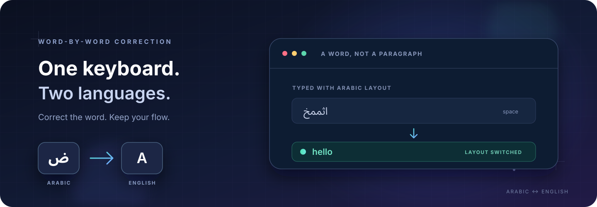

<p align="center">
  
</p>

<h1 align="center">Multilang</h1>
<p align="center"><strong>Type naturally. Let your keyboard layout catch up.</strong></p>
<p align="center">A desktop companion for Arabic and English. It checks each word at a boundary, corrects it when confidence is high, then switches the layout so you can keep typing.</p>

<p align="center">
  <a href="README.md">العربية</a>
</p>

<p align="center">
  
  
  
  
</p>

---

## Type a word. Multilang handles the layout.

If you start typing while the keyboard is set to the other language, Multilang waits until the word is complete. When there is a clear correction, it replaces that word and switches the layout. Correct or ambiguous words stay as typed.

| Typed with the wrong layout | Corrected to |
|:--|:--|
| `اثممخ` | `hello` |
| `sghl` | `سلام` |
| `hgg,pm` | `اللوحة` |

Words are checked individually. After a correction, the selected layout stays in the new language until a high-confidence word in the other language appears.

## What it does

- **Corrects one word at a time:** It does not rewrite a whole sentence because of one typo.
- **Switches the keyboard layout:** After correcting a word, it asks the system to keep typing in the matching language.
- **Leaves uncertain words alone:** Rare or ambiguous words are not guessed at.
- **Runs locally:** Word scoring uses local data; typed text is not sent to an external service.
- **Stays in the system tray:** Press **Start** and the window hides while Multilang continues running.

## Compatibility

| Environment | Status | Notes |
|:--|:--|:--|
| **KDE Plasma on Wayland** | Used and verified on EndeavourOS | Requires the Fcitx5 add-on and works in apps that accept Fcitx input. Some Wayland apps do not expose this input path. |
| **Linux on X11** | Supported with suitable system settings | Keyboard capture and layout switching depend on the X11 session and available layout tools. |
| **Windows** | Experimental preview | Uses Windows APIs for text input and layout switching. This version has not been verified on a Windows device. |
| **Wayland outside KDE** | Not currently supported | Wayland isolation prevents global key monitoring; the current Fcitx add-on targets KDE/KWin. |

The app expects **US English** and **Arabic 101** keyboard layouts.

## Install and run

Requires Python 3.10 or newer. The first install needs an internet connection to download Python packages and word data. Word scoring then runs offline.

### Linux and Windows

```bash
git clone https://github.com/telhariri/multilang-keyboard.git
cd multilang-keyboard
```

On Linux, create the virtual environment, install dependencies, and start the app:

```bash
python3 -m venv .venv
source .venv/bin/activate
python -m pip install -r requirements.txt
python main.py
```

On Windows, use PowerShell:

```powershell
py -3 -m venv .venv
.\.venv\Scripts\Activate.ps1
python -m pip install -r requirements.txt
python main.py
```

Click **Start** in the app window. Multilang moves to the system tray; its menu can reopen the window, stop monitoring, or exit.

### KDE Plasma on Wayland

After installing the Python dependencies, install the Fcitx5 add-on and settings once on Arch Linux or EndeavourOS:

```bash
./scripts/install-wayland-ime.sh
```

The script uses `sudo` to install system packages and the add-on. Log out and back in if KDE does not immediately detect the input method or both keyboard layouts. Then run `python main.py` and click **Start**; the app activates Multilang in Fcitx5 automatically.

## Privacy and how it works

Word scoring uses the local `wordfreq` data. The app does not log typed text or send it over the network. In the Wayland integration, Fcitx sends only the current word to the app through a local socket restricted to the current user.

A correction must pass a minimum word-frequency score and clearly beat the score for the other language. If frequency data is unavailable or the result is ambiguous, the text stays unchanged. The project uses Python for the UI and correction logic, an optional Rust keyboard hook for Windows, and a C++ Fcitx5 add-on for KDE Wayland.

## Project structure

```text
main.py                       UI, language detection, and correction
windows_backend.py            Windows keyboard integration
rust_backend.py               Optional Rust library interface
native/                       Rust keyboard hook source
wayland/fcitx5/                KDE Wayland Fcitx5 add-on
wayland_backend.py             Local correction service over a Unix socket
scripts/install-wayland-ime.sh Arch and EndeavourOS Wayland setup
tests/                         Python tests
```

## Contributing

Run the Python and Rust suites from the project root:

```bash
python -m unittest discover -s tests
cargo test --manifest-path native/Cargo.toml
```

See [README.md](README.md) for Arabic. This project is an early preview; Windows support still needs hands-on verification on a Windows device.
