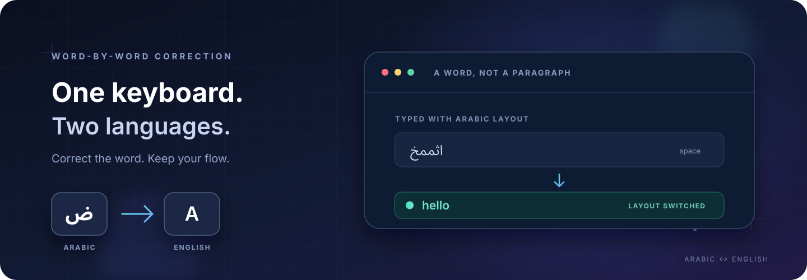

<p align="center">
  
</p>

<h1 align="center">Multilang</h1>
<p align="center"><strong>Type naturally. Let your keyboard layout catch up.</strong></p>
<p align="center">A desktop companion for Arabic and English. It checks each word at a boundary, corrects it when confidence is high, then switches the layout so you can keep typing.</p>

<p align="center">
  <a href="README.md">العربية</a> ·
  <a href="CHANGELOG.md">Changelog</a> ·
  <a href="https://github.com/telhariri/multilang-keyboard/releases/latest">Latest Release</a>
</p>

<p align="center">
  
  
  
  
  
  
</p>

---

## Type a word. Multilang handles the layout.

If you start typing while the keyboard is set to the other language, Multilang waits until the word is complete. When there is a clear correction, it replaces that word and switches the layout. Correct or ambiguous words stay as typed.

| Typed with the wrong layout | Corrected to |
|:--|:--|
| `اثممخ` | `hello` |
| `قهلاف` | `right` |
| `sghl` | `سلام` |
| `Hkh` | `أنا` |
| `hgg,pm` | `اللوحة` |

Words are checked individually. After a correction, the selected layout stays in the new language until a high-confidence word in the other language appears.

## What it does

- **Corrects one word at a time:** It does not rewrite a whole sentence because of one typo.
- **Switches the keyboard layout:** After correcting a word, it asks the system to keep typing in the matching language.
- **Leaves uncertain words alone:** Rare or ambiguous words are not guessed at.
- **Runs locally:** Word scoring uses local data; typed text is not sent to an external service.
- **Stays in the system tray:** Press **Start** and the window hides while Multilang continues running.

## Compatibility

| Environment | Status | Notes |
|:--|:--|:--|
| **KDE Plasma on Wayland** | Used and verified on EndeavourOS | Runs as a silent Fcitx5 module over your two layouts (`keyboard-us` and `keyboard-ara`) with no third input method. |
| **Linux on X11** | Supported with suitable system settings | Keyboard capture and layout switching depend on the X11 session and `libX11` / `xkb-switch`. |
| **Windows 10/11 (64-bit)** | Supported | Installer and portable package are available from [the latest release](https://github.com/telhariri/multilang-keyboard/releases/latest). Uses a native Rust keyboard hook and Windows APIs for text input and layout switching. |
| **Wayland outside KDE** | Not currently supported | Wayland isolation prevents global key monitoring; the current Fcitx module targets KDE/KWin. |

The app expects **US English** and **Arabic 101** keyboard layouts.

## Download and install

Ready-to-use release packages and `SHA256SUMS.txt` are published on the [GitHub Releases page](https://github.com/telhariri/multilang-keyboard/releases/latest):

- **Windows 10/11 (Installer):** [Multilang-Setup.exe](https://github.com/telhariri/multilang-keyboard/releases/latest/download/Multilang-Setup.exe)
- **Windows 10/11 (Portable):** [Multilang-Windows-x64.zip](https://github.com/telhariri/multilang-keyboard/releases/latest/download/Multilang-Windows-x64.zip)
- **Linux (Release tarball + installer):** [Multilang-Linux-x64.tar.gz](https://github.com/telhariri/multilang-keyboard/releases/latest/download/Multilang-Linux-x64.tar.gz)
- **Checksums:** [SHA256SUMS.txt](https://github.com/telhariri/multilang-keyboard/releases/latest/download/SHA256SUMS.txt)

### Windows 10/11 (64-bit)

Download the [Multilang installer](https://github.com/telhariri/multilang-keyboard/releases/latest/download/Multilang-Setup.exe) or [portable package](https://github.com/telhariri/multilang-keyboard/releases/latest/download/Multilang-Windows-x64.zip). The Windows build does not require Python or Rust. The installer adds a Start Menu shortcut and can create a desktop shortcut. It starts Multilang when you sign in by default; clear that option during setup to disable automatic startup.

Make sure **US English** and **Arabic 101** keyboard layouts are installed in Windows Settings. Multilang runs in the system tray; use its menu to open the window, stop correction, or exit.

### Linux (from release tarball)

Download [Multilang-Linux-x64.tar.gz](https://github.com/telhariri/multilang-keyboard/releases/latest/download/Multilang-Linux-x64.tar.gz), extract it, and run the installer (supports Arch/EndeavourOS, Debian/Ubuntu, and Fedora):

```bash
tar -xzf Multilang-Linux-x64.tar.gz
cd Multilang-Linux-x64
./scripts/install-linux.sh --autostart
```

This installs Multilang into `~/.local/share/multilang`, adds the `multilang` command launcher and desktop entry, and on **KDE Plasma Wayland** automatically builds and configures the Fcitx5 background module (requires `sudo` for system Fcitx5 files). Omit `--autostart` if you prefer manual launch, or pass `--skip-wayland` to skip Fcitx5 setup. To uninstall: `~/.local/share/multilang/scripts/uninstall-linux.sh`.

### Linux (from source)

Running from source requires Python 3.10 or newer. The first install needs an internet connection to download Python packages and word data. Word scoring then runs offline:

```bash
git clone https://github.com/telhariri/multilang-keyboard.git
cd multilang-keyboard
./scripts/install-linux.sh
```

Or run manually from a virtual environment:

```bash
python3 -m venv .venv
source .venv/bin/activate
python -m pip install -r requirements.txt
# Optional on KDE Plasma Wayland:
./scripts/install-wayland-ime.sh
python main.py
```

## Privacy and how it works

Word scoring uses the local `wordfreq` data. The app does not log typed text or send it over the network. In the Wayland integration, Fcitx sends only the current word to the app through a local socket restricted to the current user.

A correction must pass a minimum word-frequency score and clearly beat the score for the other language. If frequency data is unavailable or the result is ambiguous, the text stays unchanged. The project uses Python for the UI and correction logic, a native Rust keyboard hook on Windows, and a C++ Fcitx5 module for KDE Wayland.

## Project structure

```text
main.py                         UI, monitoring, and app lifecycle
recognizer.py                   Language scoring, disambiguation, and key mapping
layout_switcher.py              Keyboard layout switcher for Windows and Linux
windows_backend.py             Fallback Windows keyboard and mouse hook
rust_backend.py                 Rust native library interface
native/                         Rust keyboard hook source
multilang.spec                  Windows application build configuration
windows/installer.iss           Windows installer configuration
.github/workflows/release.yml   Unified Windows & Linux CI and release workflow
wayland/fcitx5/                 KDE Wayland Fcitx5 module and CTest logic suite
wayland_backend.py             Local correction service over a Unix socket
scripts/install-linux.sh        Unified Linux installer
scripts/install-wayland-ime.sh  Fcitx5 setup for Arch, Ubuntu, and Fedora
scripts/uninstall-linux.sh      Linux uninstaller
scripts/build-linux-release.sh  Reproducible Linux release tarball builder
tests/                          Python test suites
```

## CLI options

- `--start-in-background`: Start monitoring automatically and hide to the system tray.
- `--debug`: Enable privacy-safe diagnostic logging to `stderr` (never logs typed text).
- `--self-test`: Verify local `wordfreq` models and baseline recognition rules, then exit.
- `--version`: Print the application version.

## Support the project and share feedback

If you find Multilang useful, please support this project and similar projects: star the repository, share it with others, or contribute. Feedback, bug reports, and suggestions help me improve the tool. When reporting an issue, include reproduction steps and your operating system in a [new GitHub issue](https://github.com/telhariri/multilang-keyboard/issues).

## License

This project is licensed under the **MIT License**. You may use, modify, and distribute it provided that the copyright and license notices are retained. See [LICENSE](LICENSE) for the full terms.

## Contributing

Run the Python, Rust, and C++ (CTest) test suites from the project root:

```bash
python -m unittest discover -s tests -v
python main.py --self-test
cargo test --manifest-path native/Cargo.toml
cmake -S wayland/fcitx5 -B build/fcitx5 -DCMAKE_BUILD_TYPE=Release -DBUILD_TESTING=ON
cmake --build build/fcitx5 --parallel
ctest --test-dir build/fcitx5 --output-on-failure
```

See [README.md](README.md) for Arabic. Windows and Linux release packages are built, verified, and published automatically via GitHub Actions.
