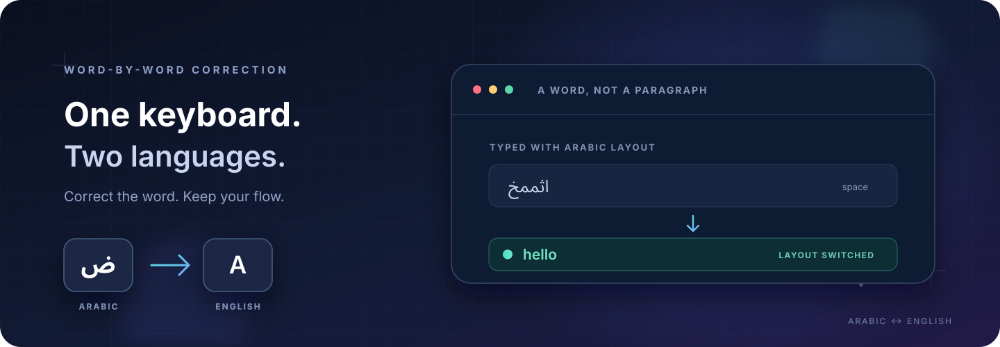

<p align="center">
  
</p>

<h1 align="center">Multilang</h1>
<p align="center"><strong>اكتب بطبيعتك. يصحّح Multilang تخطيط لوحة المفاتيح عند الحاجة.</strong></p>
<p align="center">مساعد سطح مكتب للعربية والإنجليزية: يراجع الكلمة عند المسافة، يصحّحها عندما تكون الثقة عالية، ثم يبدّل التخطيط لتكمل الكتابة.</p>

<p align="center">
  <a href="README.en.md">English</a> ·
  <a href="CHANGELOG.md">سجل التغييرات</a> ·
  <a href="https://github.com/telhariri/multilang-keyboard/releases/latest">أحدث إصدار</a>
</p>

<p align="center">
  
  
  
  
  
  
</p>

---

## اكتب، ودع التخطيط يلحق بك

إذا بدأت كلمة بينما تخطيط لوحة المفاتيح على اللغة الأخرى، ينتظر Multilang حتى تنهيها. عند وجود تصحيح واضح، يستبدل الكلمة وحدها ويحوّل التخطيط تلقائيًا؛ أما الكلمات الصحيحة أو الملتبسة فيتركها كما هي.

| كُتبت على التخطيط الخطأ | تصبح |
|:--|:--|
| `اثممخ` | `hello` |
| `قهلاف` | `right` |
| `sghl` | `سلام` |
| `Hkh` | `أنا` |
| `hgg,pm` | `اللوحة` |

تُفحص كل كلمة على حدة. بعد التصحيح، يبقى التخطيط على اللغة الجديدة حتى تظهر كلمة عالية الثقة باللغة المقابلة.

## لماذا Multilang؟

- **تصحيح عند الكلمة، لا عند الفقرة:** لا يعيد كتابة الجملة كلها بسبب كلمة واحدة.
- **تبديل تلقائي للتخطيط:** يصحّح الكلمة ويطلب من النظام متابعة الكتابة باللغة المناسبة.
- **يتحفظ عند الشك:** الكلمات النادرة أو الملتبسة لا تُحوّل بالتخمين.
- **يعمل محليًا:** تقييم الكلمات يعتمد على بيانات محلية، ولا يرسل التطبيق ما تكتبه إلى خدمة خارجية.
- **واجهة خفيفة:** بعد الضغط على «تشغيل»، ينتقل التطبيق إلى أيقونة شريط النظام.

## التوافق

| البيئة | الحالة | ملاحظات |
|:--|:--|:--|
| **KDE Plasma على Wayland** | مستخدم ومتحقق منه على EndeavourOS | يعمل عبر وحدة Fcitx5 خلفية مع لغتَيك فقط (`keyboard-us` و`keyboard-ara`) دون إضافة لغة ثالثة. |
| **Linux على X11** | مدعوم مع إعدادات النظام المناسبة | يعتمد اعتراض المفاتيح وتبديل التخطيط على جلسة X11 و`libX11` / `xkb-switch`. |
| **Windows 10/11 (64 بت)** | مدعوم | يتوفر مثبت وحزمة محمولة من [أحدث إصدار](https://github.com/telhariri/multilang-keyboard/releases/latest). يستخدم خطاف لوحة مفاتيح أصليًا بـRust وواجهات Windows للإدخال والتبديل. |
| **Wayland خارج KDE** | غير مدعوم حاليًا | عزل Wayland يمنع مراقبة المفاتيح عالميًا؛ وحدة Fcitx الحالية تستهدف KDE/KWin. |

يفترض التطبيق تخطيطي **US English** و**Arabic 101**.

## التنزيل والتثبيت

جميع الحزم الجاهزة وملفات التحقق `SHA256SUMS.txt` متاحة للتحميل المباشر من [صفحة الإصدارات على GitHub](https://github.com/telhariri/multilang-keyboard/releases/latest):

- **Windows 10/11 (مثبّت):** [Multilang-Setup.exe](https://github.com/telhariri/multilang-keyboard/releases/latest/download/Multilang-Setup.exe)
- **Windows 10/11 (نسخة محمولة):** [Multilang-Windows-x64.zip](https://github.com/telhariri/multilang-keyboard/releases/latest/download/Multilang-Windows-x64.zip)
- **Linux (حزمة الإصدار مع سكربت التثبيت):** [Multilang-Linux-x64.tar.gz](https://github.com/telhariri/multilang-keyboard/releases/latest/download/Multilang-Linux-x64.tar.gz)
- **بصمات التحقق:** [SHA256SUMS.txt](https://github.com/telhariri/multilang-keyboard/releases/latest/download/SHA256SUMS.txt)

### Windows 10/11 (64 بت)

نزّل [مثبّت Multilang](https://github.com/telhariri/multilang-keyboard/releases/latest/download/Multilang-Setup.exe) أو [الحزمة المحمولة](https://github.com/telhariri/multilang-keyboard/releases/latest/download/Multilang-Windows-x64.zip). لا يحتاج إصدار Windows إلى تثبيت Python أو Rust. يضيف المثبّت اختصارًا إلى قائمة ابدأ، ويتيح إنشاء اختصار على سطح المكتب. يبدأ التطبيق مع تسجيل الدخول افتراضيًا؛ أزل تحديد الخيار أثناء التثبيت لإيقاف التشغيل التلقائي.

تأكد من إضافة تخطيطي **US English** و**Arabic 101** في إعدادات Windows. يعمل التطبيق في شريط النظام؛ افتح قائمته لإظهار النافذة أو إيقاف التصحيح أو الخروج.

### Linux (من حزمة الإصدار الجاهزة)

نزّل [Multilang-Linux-x64.tar.gz](https://github.com/telhariri/multilang-keyboard/releases/latest/download/Multilang-Linux-x64.tar.gz)، فكّ الضغط، ثم شغّل المثبّت (يدعم Arch/EndeavourOS وDebian/Ubuntu وFedora):

```bash
tar -xzf Multilang-Linux-x64.tar.gz
cd Multilang-Linux-x64
./scripts/install-linux.sh --autostart
```

يُثبّت السكربت التطبيق في `~/.local/share/multilang`، ويضيف الأمر `multilang` واختصار التطبيقات، وإذا كنت على **KDE Plasma Wayland** يبني ويثبّت وحدة Fcitx5 تلقائيًا (يتطلب `sudo` للخطوة الخاصة بـFcitx5). أزل الخيار `--autostart` إذا لم ترغب بالتشغيل التلقائي، أو مرّر `--skip-wayland` لتجاوز إعداد Wayland. للإزالة: `~/.local/share/multilang/scripts/uninstall-linux.sh`.

### Linux (من المصدر للمطورين)

يتطلب تشغيل نسخة المصدر Python 3.10 أو أحدث. يحتاج التثبيت الأول إلى اتصال بالإنترنت لتنزيل المكتبات وبيانات الكلمات؛ بعد ذلك يعمل التقييم دون اتصال:

```bash
git clone https://github.com/telhariri/multilang-keyboard.git
cd multilang-keyboard
./scripts/install-linux.sh
```

أو للتشغيل اليدوي داخل بيئة افتراضية:

```bash
python3 -m venv .venv
source .venv/bin/activate
python -m pip install -r requirements.txt
# على KDE Plasma Wayland (اختياري بعد التثبيت الأول):
./scripts/install-wayland-ime.sh
python main.py
```

## الخصوصية وطريقة العمل

تُقيّم الكلمات باستخدام بيانات `wordfreq` المحلية. لا يسجّل التطبيق النص ولا يرسله إلى الشبكة. في تكامل Wayland، يمرّر Fcitx الكلمة الحالية فقط إلى التطبيق عبر مقبس محلي مقيّد بحساب المستخدم.

يقبل المصحح التحويل عندما تتجاوز درجة تكرار الكلمة حدًا أدنى وتتفوق بوضوح على اللغة الأخرى. إن لم تتوفر بيانات التكرار أو لم تكن النتيجة واضحة، يبقى النص كما كُتب. يستخدم المشروع Python للواجهة والتصحيح، ومراقب لوحة مفاتيح أصليًا بـRust على Windows، وإضافة C++ لـFcitx5 على KDE Wayland.

## بنية المشروع

```text
main.py                         الواجهة، المراقبة، وإدارة دورة الحياة
recognizer.py                   تحليل اللغة، حل الغموض، واستبدال التخطيط
layout_switcher.py              تبديل تخطيط لوحة المفاتيح على Windows وLinux
windows_backend.py              خطاف لوحة المفاتيح والماوس الاحتياطي في Windows
rust_backend.py                 واجهة مكتبة Rust الأصلية
native/                         مصدر مراقب لوحة المفاتيح بـRust
multilang.spec                  إعداد بناء تطبيق Windows
windows/installer.iss           إعداد مثبت Windows
.github/workflows/release.yml   بناء واختبار ونشر إصدارات Windows وLinux
wayland/fcitx5/                 إضافة Fcitx5 لـKDE Wayland مع اختبارات CTest
wayland_backend.py              خدمة التصحيح المحلية عبر مقبس Unix
scripts/install-linux.sh        مثبّت Linux المتكامل
scripts/install-wayland-ime.sh  تثبيت وحدة Fcitx5 على Arch/Ubuntu/Fedora
scripts/uninstall-linux.sh      إزالة تثبيت Linux
scripts/build-linux-release.sh  إنشاء أرشيف إصدار Linux
tests/                          اختبارات Python الشاملة
```

## خيارات سطر الأوامر (CLI)

- `--start-in-background`: بدء المراقبة تلقائيًا وإبقاء التطبيق في شريط النظام.
- `--debug`: تفعيل سجل تشخيصي على `stderr` دون تسجيل أي كلمة أو حرف يكتبه المستخدم.
- `--self-test`: التحقق السريع من نماذج `wordfreq` وقواعد التعرف الأساسية.
- `--version`: عرض رقم الإصدار الحالي.

## ادعم المشروع وشارك رأيك

إذا وجدت Multilang مفيدًا، أطلب منك دعم هذا المشروع والمشاريع المشابهة: امنح المستودع نجمة، شاركه مع المهتمين، أو ساهم في تطويره. ملاحظاتك وتقارير الأخطاء واقتراحاتك تساعدني على تحسين الأداة؛ أضف خطوات إعادة المشكلة ونظام التشغيل الذي تستخدمه في [مشكلة جديدة على GitHub](https://github.com/telhariri/multilang-keyboard/issues).

## الترخيص

هذا المشروع مرخّص بموجب **MIT**. يمكنك استخدامه وتعديله وتوزيعه مع الإبقاء على إشعار حقوق النشر ونص الترخيص؛ راجع ملف [LICENSE](LICENSE) للتفاصيل.

## للمساهمين

شغّل اختبارات Python وRust وC++ (CTest) من جذر المشروع:

```bash
python -m unittest discover -s tests -v
python main.py --self-test
cargo test --manifest-path native/Cargo.toml
cmake -S wayland/fcitx5 -B build/fcitx5 -DCMAKE_BUILD_TYPE=Release -DBUILD_TESTING=ON
cmake --build build/fcitx5 --parallel
ctest --test-dir build/fcitx5 --output-on-failure
```

راجع [README.en.md](README.en.md) للنسخة الإنجليزية. تُبنى حزم Windows وLinux وتُختبر وتُنشر آليًا عبر GitHub Actions.
