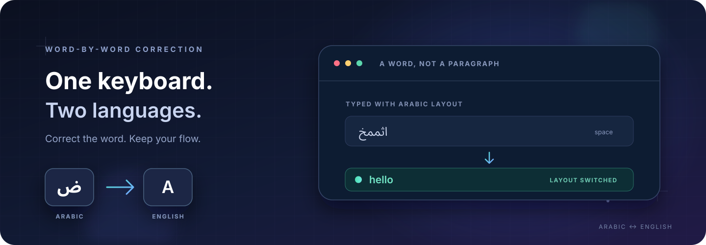

<p align="center">
  
</p>

<h1 align="center">Multilang</h1>
<p align="center"><strong>اكتب بطبيعتك. يصحّح Multilang تخطيط لوحة المفاتيح عند الحاجة.</strong></p>
<p align="center">مساعد سطح مكتب للعربية والإنجليزية: يراجع الكلمة عند المسافة، يصحّحها عندما تكون الثقة عالية، ثم يبدّل التخطيط لتكمل الكتابة.</p>

<p align="center">
  <a href="README.en.md">English</a>
</p>

<p align="center">
  
  
  
  
  
</p>

---

## اكتب، ودع التخطيط يلحق بك

إذا بدأت كلمة بينما تخطيط لوحة المفاتيح على اللغة الأخرى، ينتظر Multilang حتى تنهيها. عند وجود تصحيح واضح، يستبدل الكلمة وحدها ويحوّل التخطيط تلقائيًا؛ أما الكلمات الصحيحة أو الملتبسة فيتركها كما هي.

| كُتبت على التخطيط الخطأ | تصبح |
|:--|:--|
| `اثممخ` | `hello` |
| `sghl` | `سلام` |
| `hgg,pm` | `اللوحة` |

تُفحص كل كلمة على حدة. بعد التصحيح، يبقى التخطيط على اللغة الجديدة حتى تظهر كلمة عالية الثقة باللغة المقابلة.

## لماذا Multilang؟

- **تصحيح عند الكلمة، لا عند الفقرة:** لا يعيد كتابة الجملة كلها بسبب كلمة واحدة.
- **تبديل تلقائي للتخطيط:** يصحّح الكلمة ويطلب من النظام متابعة الكتابة باللغة المناسبة.
- **يتحفظ عند الشك:** الكلمات النادرة أو الملتبسة لا تُحوّل بالتخمين.
- **يعمل محليًا:** تقييم الكلمات يعتمد على بيانات محلية، ولا يرسل التطبيق ما تكتبه إلى خدمة خارجية.
- **واجهة خفيفة:** بعد الضغط على «تشغيل»، ينتقل التطبيق إلى أيقونة شريط النظام.

## التوافق

| البيئة | الحالة | ملاحظات |
|:--|:--|:--|
| **KDE Plasma على Wayland** | مستخدم ومتحقق منه على EndeavourOS | يتطلب إضافة Fcitx5؛ يعمل في التطبيقات التي تقبل الإدخال عبر Fcitx. بعض تطبيقات Wayland لا تتيح هذا النوع من الإدخال. |
| **Linux على X11** | مدعوم مع إعدادات النظام المناسبة | يعتمد اعتراض المفاتيح وتبديل التخطيط على جلسة X11 وأدوات التخطيط المتاحة. |
| **Windows** | معاينة تجريبية | يستخدم واجهات Windows لإدخال النص وتبديل التخطيط. لم تُتحقق هذه النسخة على جهاز Windows ضمن هذا الإصدار. |
| **Wayland خارج KDE** | غير مدعوم حاليًا | عزل Wayland يمنع مراقبة المفاتيح عالميًا؛ إضافة Fcitx الحالية تستهدف KDE/KWin. |

يفترض التطبيق تخطيطي **US English** و**Arabic 101**.

## التثبيت والتشغيل

يتطلب Python 3.10 أو أحدث. يحتاج التثبيت الأول إلى اتصال بالإنترنت لتنزيل المكتبات وبيانات الكلمات؛ بعد ذلك يعمل التقييم دون اتصال.

### Linux وWindows

```bash
git clone https://github.com/telhariri/multilang-keyboard.git
cd multilang-keyboard
```

على Linux، أنشئ البيئة الافتراضية ثم ثبّت المتطلبات وشغّل التطبيق:

```bash
python3 -m venv .venv
source .venv/bin/activate
python -m pip install -r requirements.txt
python main.py
```

على Windows، استخدم PowerShell:

```powershell
py -3 -m venv .venv
.\.venv\Scripts\Activate.ps1
python -m pip install -r requirements.txt
python main.py
```

عند فتح الواجهة اضغط **تشغيل**. سيعمل التطبيق في الخلفية وتظهر أيقونته في شريط النظام؛ من قائمة الأيقونة يمكنك فتح الواجهة أو إيقاف المراقبة أو الخروج.

### KDE Plasma على Wayland

بعد تثبيت متطلبات Python، ثبّت إضافة Fcitx5 وإعداداتها مرة واحدة على Arch Linux أو EndeavourOS:

```bash
./scripts/install-wayland-ime.sh
```

يتطلب السكربت كلمة مرور `sudo` لتثبيت الحزم والإضافة. سجّل الخروج ثم ادخل مجددًا إذا لم يتعرف KDE على طريقة الإدخال أو تخطيطي العربية والإنجليزية فورًا. بعد ذلك شغّل `python main.py` واضغط **تشغيل**؛ يفعّل التطبيق Multilang في Fcitx5 تلقائيًا.

## الخصوصية وطريقة العمل

تُقيّم الكلمات باستخدام بيانات `wordfreq` المحلية. لا يسجّل التطبيق النص ولا يرسله إلى الشبكة. في تكامل Wayland، يمرّر Fcitx الكلمة الحالية فقط إلى التطبيق عبر مقبس محلي مقيّد بحساب المستخدم.

يقبل المصحح التحويل عندما تتجاوز درجة تكرار الكلمة حدًا أدنى وتتفوق بوضوح على اللغة الأخرى. إن لم تتوفر بيانات التكرار أو لم تكن النتيجة واضحة، يبقى النص كما كُتب. يستخدم المشروع Python للواجهة والتصحيح، وRust لمراقب Windows الاختياري، وإضافة C++ لـFcitx5 على KDE Wayland.

## بنية المشروع

```text
main.py                       الواجهة، كشف اللغة، والتصحيح
windows_backend.py            تكامل لوحة المفاتيح في Windows
rust_backend.py               واجهة مكتبة Rust الاختيارية
native/                       مصدر مراقب لوحة المفاتيح بـRust
wayland/fcitx5/                إضافة Fcitx5 لـKDE Wayland
wayland_backend.py             خدمة التصحيح المحلية عبر مقبس Unix
scripts/install-wayland-ime.sh تثبيت إضافة Wayland على Arch وEndeavourOS
tests/                         اختبارات Python
```

## ادعم المشروع وشارك رأيك

إذا وجدت Multilang مفيدًا، أطلب منك دعم هذا المشروع والمشاريع المشابهة: امنح المستودع نجمة، شاركه مع المهتمين، أو ساهم في تطويره. ملاحظاتك وتقارير الأخطاء واقتراحاتك تساعدني على تحسين الأداة؛ أضف خطوات إعادة المشكلة ونظام التشغيل الذي تستخدمه في [مشكلة جديدة على GitHub](https://github.com/telhariri/multilang-keyboard/issues).

## الترخيص

هذا المشروع مرخّص بموجب **MIT**. يمكنك استخدامه وتعديله وتوزيعه مع الإبقاء على إشعار حقوق النشر ونص الترخيص؛ راجع ملف [LICENSE](LICENSE) للتفاصيل.

## للمساهمين

شغّل اختبارات Python وRust من جذر المشروع:

```bash
python -m unittest discover -s tests
cargo test --manifest-path native/Cargo.toml
```

راجع [README.en.md](README.en.md) للنسخة الإنجليزية. المشروع في مرحلة معاينة؛ دعم Windows ما زال يحتاج تحققًا عمليًا على جهاز Windows.
